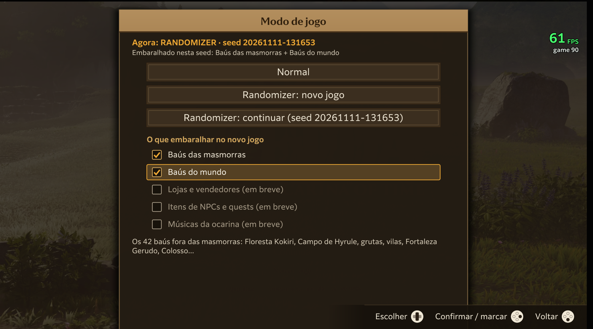
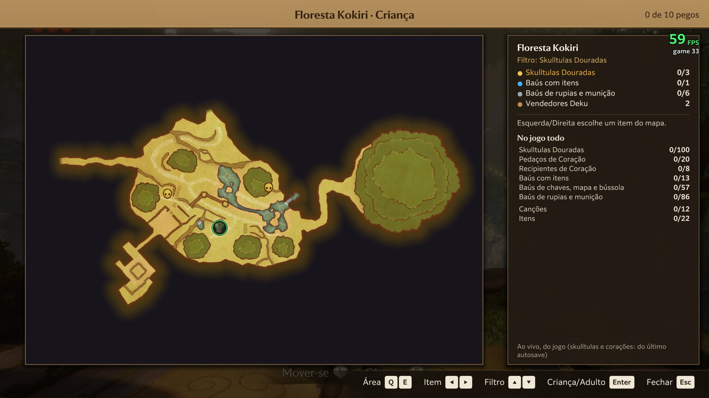
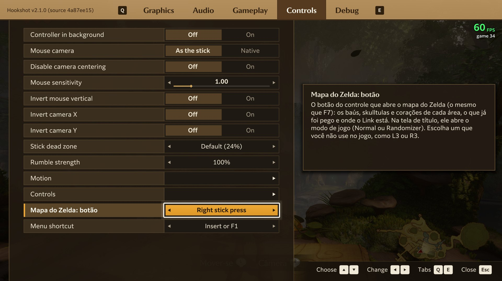
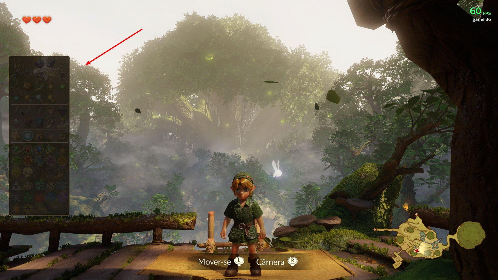
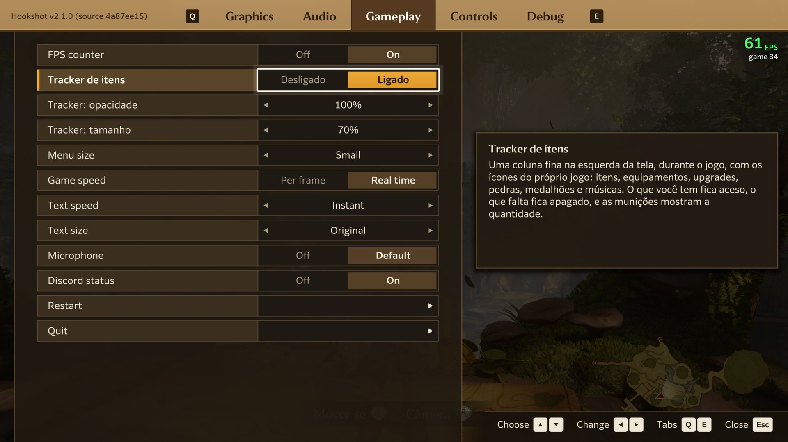
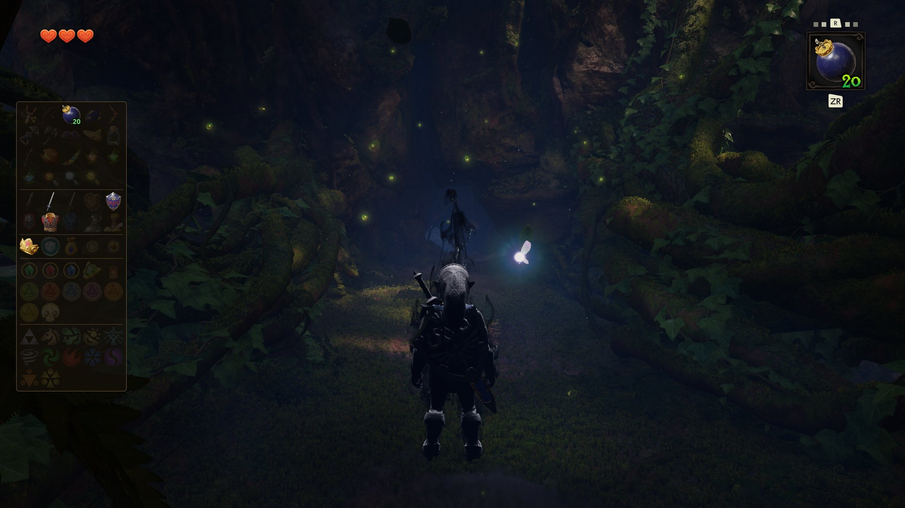
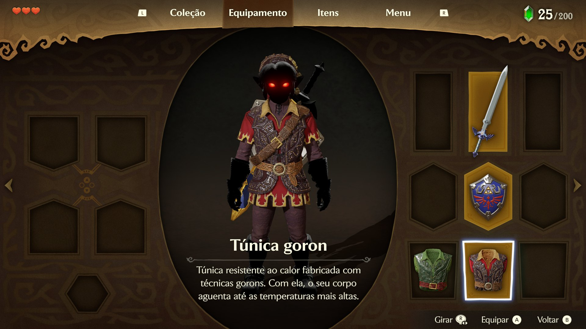
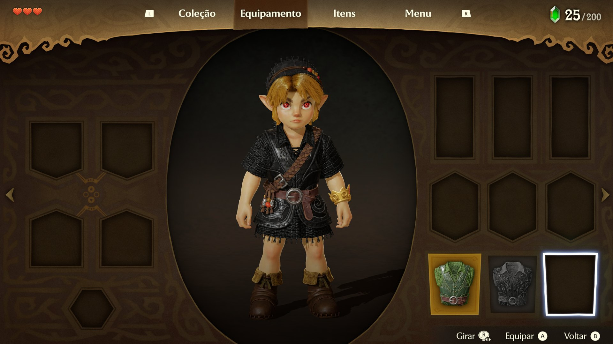
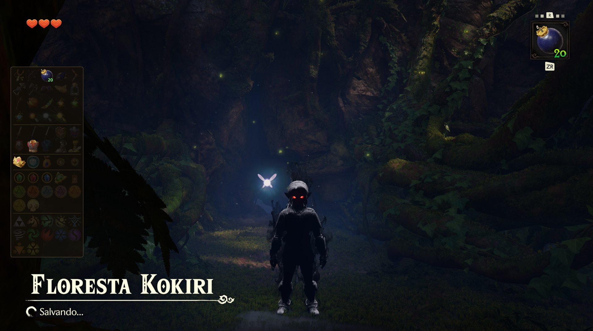
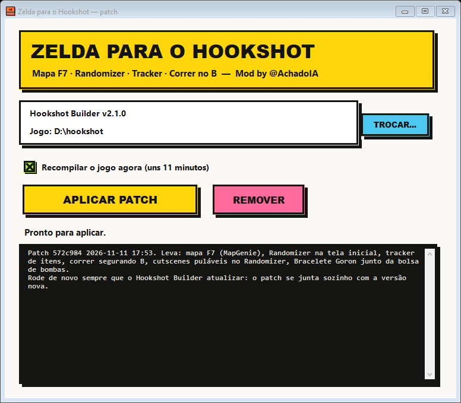

# Zelda para o Hookshot

Mod para **The Legend of Zelda: Ocarina of Time** (o Remake) rodando **nativo no PC** pelo **Hookshot** —
tudo **dentro do jogo**, sem janela separada:

- **Randomizer** no estilo do *Ship of Harkinian*: baús, lojas, NPCs/quests e músicas da ocarina embaralhados, com lógica que
  garante que a seed dá para zerar.
- **Mapa F7** no estilo MapGenie: baús, skulltulas e corações de cada área, o que já foi pego e onde o Link está — ao vivo.
- **Tracker de itens**: uma coluna fina na esquerda da tela com os ícones originais do Remake, mostrando o que você tem e o que
  falta, com transparência e tamanho ajustáveis.
- **Dark Link**: o Link adulto vira o Dark Link de verdade (modelo, Espada Mestra e Escudo Hylian sombrios e a aura), usando
  os modelos que já existem dentro do jogo.
- **Aba Mods** no menu do Hookshot (F1): liga e desliga cada mod da pasta `mods` sem mexer em arquivos.
- **Correr no R**, **menu do Hookshot pelo controle** (L3 + R3) e outros ajustes.
- Um **patch .exe** que se aplica sozinho a cada versão nova do Hookshot e instala tudo isso de uma vez.

> O motor do randomizer (lógica, leitura dos arquivos do jogo, gerador de seeds) fica no repositório irmão
> [**OoT-Notas**](https://github.com/achadoia/OoT-Notas). Este aqui é a parte que entra no Hookshot.

---

## Randomizer



Na **tela de título**, aperte **F7** (ou o botão do controle escolhido em *Controles > Mapa do Zelda: botão*) para abrir o
**Modo de jogo**:

| Opção | O que faz |
|---|---|
| **Normal** | A campanha de sempre. Nada muda nos arquivos do jogo. |
| **Randomizer: novo jogo** | Gera uma seed nova (20–40 s) com o que estiver marcado e reinicia o jogo nela. |
| **Randomizer: continuar** | Volta para a seed atual e o save dela. |

O randomizer **só vale para um novo jogo** e usa **saves separados** (`user\save_randomizer`): a sua campanha normal nunca é
tocada. Ao gerar uma seed nova, o save randomizer anterior é guardado numa pasta com a data.

### O que dá para embaralhar (caixas de seleção, como no Ship of Harkinian)

| Caixa | O que entra |
|---|---|
| **Baús das masmorras** | Os 56 baús de dentro das masmorras (chaves, mapas e bússolas ficam no lugar). |
| **Baús do mundo** | Os 42 baús fora das masmorras: Floresta Kokiri, Campo de Hyrule, grutas, vilas, Fortaleza Gerudo... |
| **Lojas e vendedores** | O que cada loja vende troca de lugar (com o preço junto) e os Deku vendedores trocam as mercadorias. |
| **Itens de NPCs e quests** | 48 entregas: Grandes Fadas, Saria (ocarina), Zelda (carta, Ocarina do Tempo, Flechas de Luz), Darunia, Rei Zora, Anju, minigames (alvos, boliche, pesca, mergulho, arco a cavalo), trocas do Biggoron, peças de coração de NPCs... |
| **Músicas da ocarina** | As 12 músicas trocam de professor: a Impa pode ensinar o Bolero, o Sheik da cratera a Canção de Saria. |

Exemplo real de um spoiler (`D:\hookshot\zelda\randomizer\spoiler.txt`):

```
== Musicas e NPCs ==
  Impa (Castelo de Hyrule)                      -> Canção de Saria      (original: Cantiga de Zelda)
  Malon (Fazenda Lon Lon)                       -> Cantiga de Zelda     (original: Canção de Epona)
  Sheik (Cratera)                               -> Noturno da Sombra    (original: Bolero do Fogo)
  Grande Fada de Farore (Fonte Zora)            -> Botas de Pouso       (original: Vento de Farore)
  Skull Kid (Bosque Perdido)                    -> Magia                (original: Peça de Coração)
  Sapos (Rio Zora)                              -> Martelo Megaton      (original: Peça de Coração)
```

### Como funciona

O Ship of Harkinian troca o item **na hora da entrega**, dentro do código do jogo. O Remake entrega quase tudo por **fluxos de
evento** (`Event/EventFlow/*.bfevfl`) que levam o nome do item como parâmetro — então aqui a troca é feita **nos arquivos da
seed**, que o Hookshot põe por cima da RomFS só no modo randomizer:

- **Baús**: o item de cada baú (`Drop__DropActor`) nas cenas (`Banc/*.bcett.byml`).
- **NPCs**: o `ActorName` passado aos subfluxos de entrega (`Dm_SY_GetInEvent`, `GetPouchContent`, `NpcCommon`).
- **Músicas**: a ação de inventário de cada música no `Dm_SY_Ocarina` e a cena de cada professor (`Dm_MelodyGet_*`). A lição
  toca a música de antes; você ganha a nova.
- **Lojas**: cada vitrine é um ator `Shop_<item>` na cena; os Deku vendedores têm as mercadorias como parâmetro.
- Onde o jogo pergunta *"já entreguei?"* pelo item original (`IsGet.<item>`: Grandes Fadas, moinho, Sheik da cratera), a
  pergunta é reescrita para o item novo — por isso esses lugares só recebem itens que têm essa flag.
- **Lógica** (ideia do SoH, código próprio): *Assumed Fill* + verificação por esferas. Minigames e trocas, que podem repetir o
  prêmio, só recebem itens que não travam o progresso. O Escudo Deku à venda fica sempre numa loja de criança.
- A **ResourceSizeTable** da seed é aumentada para cada arquivo que cresceu (sem isso o motor descarta o arquivo — era a tela
  preta da primeira versão).
- No randomizer, **todas as cutscenes podem ser puladas** (a abertura e os créditos tinham trava).

---

## Mapa F7 (estilo MapGenie)



Em jogo, **F7** (ou o botão escolhido) abre o mapa da área:

- os **ícones do próprio jogo** para baús, skulltulas, peças de coração, músicas...;
- o que **já foi pego** (verde) — baús e músicas **ao vivo** (flags lidas da memória do jogo), skulltulas e corações do último
  autosave;
- **onde o Link está** e a idade (criança/adulto).

Controles: **L/R** (Q/E, roda do mouse) troca de área · **Esquerda/Direita** escolhe o item · **Cima/Baixo** filtra por
categoria · **A/Enter** alterna criança/adulto · **B/Esc/F7** fecha.

Os mapas e ícones são extraídos da própria RomFS do jogo (texturas BNTX do Switch 2, ASTC) — nenhum dado do MapGenie é usado.

O botão do controle fica em *Menu do Hookshot > Controls > **Mapa do Zelda: botão*** (ex.: apertar o analógico direito). Na
tela de título, o mesmo botão abre o **Modo de jogo**.



## Tracker de itens

*Menu do Hookshot > Gameplay > **Tracker de itens***. Uma coluna fina na esquerda da tela, só durante o jogo, com os ícones
do Remake: itens, equipamento, upgrades, pedras, medalhões e as 12 músicas. **Aceso** = você tem; **apagado** = falta;
munição com a quantidade; upgrades com o nível. *Tracker: opacidade* (10–100%) e *Tracker: tamanho* (60–160%).





---

## Dark Link





O Remake tem um **Dark Link completo** dentro dos arquivos (o chefe do Templo da Água): `Player_Adult_Dark`,
`Weapon_Sword_Master_Dark`, `Weapon_Shield_Hylian_Dark` e `Weapon_Sheath_Master_Dark`. O mod **"Dark Link (Link adulto)"**
coloca isso no Link adulto — nenhum modelo de fora:

- **Corpo e Escudo Hylian**: o pacote do ator (`Pack/Actor/Player_Adult.pack.zs`, `Weapon_Shield_Hylian.pack.zs`) passa a
  apontar o `ModelInfo` para os modelos *Dark*. O SARC é reescrito no lugar, sem crescer além da ResourceSizeTable.
- **Espada Mestra**: o jogo carrega o modelo da espada pelo nome, então trocar o `ModelInfo` não basta (o Link ficava sem
  espada). O BFRES `Weapon_Sword_Master_Dark` vai para o lugar de `Weapon_Sword_Master` com os nomes internos renomeados, e a
  entrada dele na **ResourceSizeTable** é aumentada (o arquivo novo é maior; sem isso o motor descarta o arquivo).
- **Aura**: o efeito de fumaça e os olhos vermelhos do Dark Link (`Enemy_MiddleBoss_DarkLink`) passam para o Link adulto pelo
  ELink/XLNK do Player_Adult.
- Funciona com qualquer túnica (Kokiri, Goron, Zora) e também no modo randomizer (a RSTB da seed recebe as mesmas entradas).

O gerador é o `mods/dark_link.py` (+ `dark_link_aura.py`) do [OoT-Notas](https://github.com/achadoia/OoT-Notas): ele lê os
arquivos do **seu** jogo e monta `<jogo>\mods\Dark Link (Link adulto)`. O patch .exe roda ele sozinho depois de recompilar.
Se a espada sumir depois de um Hookshot novo ou de uma seed nova, é só rodar de novo (ele refaz o aumento da RSTB).

## Aba Mods e mods do Link criança





*Menu do Hookshot (F1) > **Mods***: uma linha por pasta de `<jogo>\mods\<nome>\romfs` (até 24), **Ligado/Desligado**. O que
fica desligado vai para `zelda\mods_desligados.txt` e o Hookshot pula no início; ao fechar o menu ele pergunta se reinicia.

O patch instala junto dois mods da comunidade, prontos:

| Mod | O que faz |
|---|---|
| **Tunica preta (Link crianca)** | Túnica Kokiri preta no Link criança (*YoungLinkTunicBlack*). |
| **Olhos Sharingan (Link)** | Olhos vermelhos (*LinkEyeTextureSwaps — Red Sharingan*), **só no Link**. |

Os mods de olho trocam a íris de **todos** os personagens. `ferramentas\olho_so_link.py` faz o modelo do Link pedir uma
textura só dele (`Lnk_Inner_Iris_...`, mesmo tamanho de nome, então os BFRES não mudam de tamanho) e grava a íris do mod com
esse nome — os outros personagens ficam com o olho normal. No Link adulto com o Dark Link valem os olhos do Dark Link.

## Outros ajustes

| | |
|---|---|
| **Correr no R** | Segurando R com o analógico inclinado o Link corre como segurando A (sem subir o escudo). O B fica só B. (`correr_r=0` em `zelda\config.ini` desliga.) |
| **Menu do Hookshot pelo controle** | **L3 + R3** abre e fecha o menu do F1. *Controles > Menu do Hookshot: controle*: L3 + R3, L + R + Select ou ZL + ZR + Select. |
| **Bracelete Goron** | No randomizer, com a bolsa de bombas e sem o bracelete, ele entra junto (o Remake só deixa puxar a bomba com o bracelete). |

---

## Instalar: o patch .exe



1. Feche o jogo.
2. Abra o **`Hookshot-Zelda-Patch.exe`**. Ele acha o Hookshot Builder e a pasta do jogo sozinho (ou **TROCAR...** para apontar
   o `hookshot.exe`).
3. **APLICAR PATCH**: junta as mudanças com a versão do Hookshot instalada e recompila o jogo (~11 min).

O .exe é **autossuficiente**: além do código, ele leva o randomizer com os dados (`<jogo>\zelda\codigo`), os mods prontos
(`<jogo>\mods`, só o que faltar) e gera o **Dark Link** no fim. O `zelda\config.ini` passa a usar o Python que já vem com o
Hookshot Builder — não precisa instalar Python, Git nem clonar o OoT-Notas para jogar.

**Versão nova do Hookshot?** É só rodar o .exe de novo: ele faz uma junção em 3 vias (o arquivo novo do builder, o original da
versão em que o patch foi feito e o nosso) com um diff3 próprio — sem Python e sem Git. Se a versão nova mexer exatamente nas
mesmas linhas que o patch, ele para sem tocar em nada e guarda os arquivos marcados em `%LOCALAPPDATA%\HookshotZelda\conflitos`.
**REMOVER** devolve o Hookshot original.

O .exe leva os dados do mapa extraídos do jogo, por isso **não é distribuído aqui**: monte o seu com
`python patcher\build.py` (precisa do jogo e do [OoT-Notas](https://github.com/achadoia/OoT-Notas) para gerar os dados).
Sem o .exe: `python aplicar.py` faz o mesmo.

## Estrutura

- `fonte\` — os nossos arquivos (os do builder com as mudanças + `gpu/vk/zelda_ids.h` e `gpu/vk/zelda_notas.h`).
- `originais\` — os arquivos do builder na versão em que as mudanças foram feitas (`originais\VERSAO.txt`), a base da junção.
- `aplicar.py` / `patcher\` — o aplicador (Python) e o patch .exe (C#, `diff3.cs`).
- `ferramentas\` — geradores dos dados do mapa e dos ícones do tracker, e o `olho_so_link.py`.
- [`LEIA-ME.md`](LEIA-ME.md) — notas técnicas detalhadas (arquivo por arquivo).

O código do Hookshot (`host\`) é GPL; as mudanças aqui seguem a mesma licença. *The Legend of Zelda* é da Nintendo — este
repositório não contém arquivos do jogo.

Mod by **@AchadoIA**.
